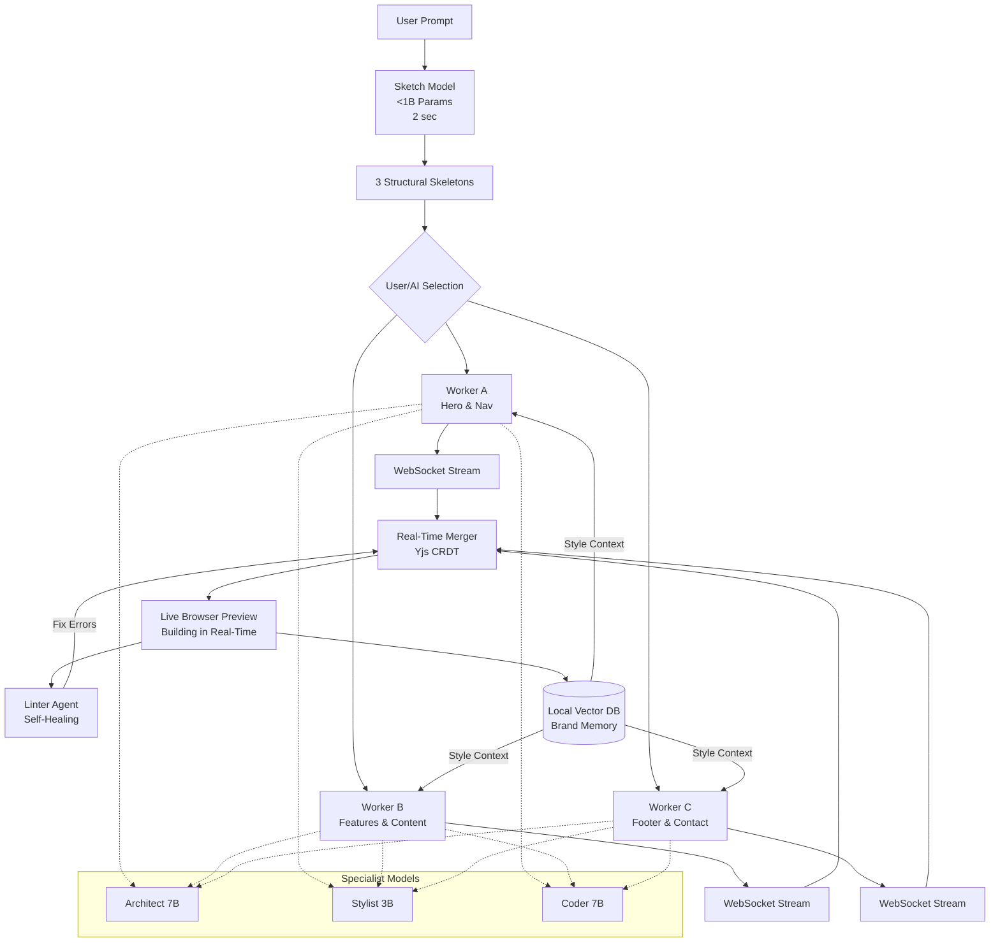

--- SOVRN_ROADMAP.md (原始)

+++ SOVRN_ROADMAP.md (修改后)
# SOVRN: Path to Production & Next-Gen Architecture

## Part 1: Making SOVRN Production-Ready

To make SOVRN production-ready, you need to bridge the gap between its ambitious architecture and the current incomplete implementation. Based on the code analysis, here is the critical path to maturity:

### 1. Implement the Core AI Agents (Critical Priority)

The current system relies on hardcoded templates because the "brains" are missing. You must implement the three distinct agents defined in the architecture:

- **Strategist Agent**: Needs to ingest user prompts, perform market analysis (via local RAG or tool calling), and output a structured `site_strategy.json` (sitemap, color palette, typography, tone).
- **Designer Agent**: Must convert the strategy into concrete UI specifications (Tailwind classes, component hierarchy, layout grids) without hallucinating invalid CSS.
- **Engineer Agent**: The code generator that takes the design specs and writes actual `.tsx`/`.html` files, ensuring React best practices and accessibility compliance.

**Action**: Develop these as modular Python classes using `llama-cpp-python` with specific system prompts and few-shot examples for each role.

### 2. Build the Visual Editor (WYSIWYG)

A static site generator is not enough; users expect to tweak the AI's output.

- **Component**: Build a Next.js-based canvas where users can click elements to edit text, swap images, and adjust styles.
- **Sync Mechanism**: Ensure changes made in the editor update the underlying JSON state and can be re-exported as code.
- **Tech Stack**: Consider integrating libraries like `grapesjs` or building a custom drag-and-drop interface using `dnd-kit` tailored for your specific component schema.

### 3. Optimize Model Performance & Quantization

Running large models locally is resource-intensive.

- **Quantization**: Standardize on `Q4_K_M` or `Q5_K_M` GGUF models to balance quality and RAM usage (targeting <8GB VRAM for consumer GPUs).
- **Context Management**: Implement sliding window attention or prompt compression to handle long website generation contexts without running out of memory.
- **Model Routing**: Create a logic layer that selects smaller models (e.g., Llama-3-8B) for simple tasks (copywriting) and larger ones (e.g., Mixtral-8x7B) for complex structural planning.

### 4. Hardening & Security

Since this is self-hosted, security falls on the implementation.

- **Sandboxing**: Ensure the code generation process runs in a restricted environment (e.g., gVisor or strict Docker limits) to prevent generated code from accessing the host filesystem maliciously.
- **Input Validation**: Rigorously sanitize user prompts to prevent prompt injection attacks that could leak system instructions or generate harmful content.
- **Authentication**: Implement robust auth (OAuth2 or OIDC) for the dashboard, even in self-hosted scenarios, to prevent unauthorized access to generated sites.

### 5. Deployment & Developer Experience (DX)

- **One-Click Install**: Create a seamless `docker-compose up` experience that automatically pulls the correct model versions and initializes the database.
- **Hardware Detection**: Add a startup check that verifies GPU availability, VRAM, and disk space, providing clear error messages if the hardware is insufficient.
- **Documentation**: Update the docs to reflect actual capabilities rather than aspirational features. Include a "Getting Started" guide for non-technical users.

### Summary Checklist for MVP Launch

- [ ] **Code Gen Pipeline**: Verify end-to-end flow from Prompt → Strategy → Design → Code.
- [ ] **Editor**: Basic text/style editing functional.
- [ ] **Export**: Ability to download the site as a static ZIP or deploy to Vercel/Netlify directly.
- [ ] **Tests**: Unit tests for agent prompts and integration tests for the build pipeline.
- [ ] **Docs**: Accurate setup guides and troubleshooting for local hardware issues.

Once these core gaps are filled, SOVRN can transition from a promising prototype to a viable alternative to cloud-based builders.

---

## Part 2: Next-Generation "Hyper-Parallel" Architecture

To build an architecture that is genuinely faster, better, and more feature-rich than cloud competitors (like Vercel v0, Framer AI, or Wix) while remaining offline/self-hosted, you must abandon the traditional "Chatbot → Wait → Generate" model.

The current SOVRN architecture (sequential agents: Strategist → Designer → Engineer) is inherently slow because it waits for each step to finish before starting the next.

Here is the blueprint for a Next-Generation **"Hyper-Parallel" Architecture**:

### 1. The Core Innovation: "Speculative Parallel Generation"

Instead of a linear chain, use a **Tree-of-Thoughts with Speculative Execution**.

**Current Way**: Plan (30s) → Design (45s) → Code (60s) = **2m 15s total**.

**New Way**:
1. **The "Sketch" Model** (Tiny, <1B params): Instantly generates 3 distinct structural skeletons (HTML/Tailwind classes only) in **<2 seconds**.
2. **User Selection**: User picks a vibe immediately (or AI auto-ranks based on prompt embedding similarity).
3. **Parallel Expansion**: Once a skeleton is picked, spin up 3 parallel workers:
   - **Worker A**: Generates Hero & Nav.
   - **Worker B**: Generates Features & Content.
   - **Worker C**: Generates Footer & Contact.
4. **Assembly**: Merge streams into a single file.

**Result**: **<15 seconds total**.

### 2. The Tech Stack for Speed (The "Engine")

#### A. Inference Engine: Replace llama-cpp-python with MLX or vLLM

**Problem**: `llama-cpp-python` is great for compatibility but often single-threaded and slow on generation throughput.

**Solution**:
- **Apple Silicon**: Use **MLX** (Apple's native framework). It offers 3-5x faster token generation than llama.cpp on Macs.
- **NVIDIA/AMD**: Use **vLLM** with PagedAttention. It handles batched requests significantly better.
- **Hybrid Approach**: Run the "Sketch" model on CPU/NPU and the "Refiner" model on GPU simultaneously.

#### B. The Model Strategy: "Distilled Specialist Swarm"

Don't use one massive 70B model for everything. It's overkill and slow.

- **Architect (7B - 8B quantized)**: Only outputs JSON structure and component tree. Fast.
- **Stylist (3B - 4B quantized)**: Specialized only on Tailwind/CSS patterns. Trained on high-quality design systems (Shadcn, Mantine).
- **Coder (7B - 8B quantized)**: Fills in logic (React/JS).

**Why this wins**: Smaller models run at 50+ tokens/sec vs 5 tokens/sec. By chaining small, specialized models, you get higher quality code faster than one generalist model trying to do it all.

#### C. State Management: "CRDT-Based Live Stream"

**Feature**: Don't wait for the full page to generate.

**Implementation**: Use **Yjs** (CRDTs) over WebSockets.
- As soon as the AI generates `<header>`, it streams directly to the browser DOM.
- The user sees the site building itself in real-time, block by block, like magic.

**Competitor Edge**: Most competitors show a loading spinner. You show progress.

### 3. Killer Features to Invent (Better than Competitors)

#### Feature 1: "Time-Travel Debugging & Undo"
Since you own the local state:
- Record every token generation and DOM mutation.
- Allow users to scrub a timeline slider back to "5 minutes ago" or "before I asked for the dark mode change."
- **Tech**: Replayable event log stored in IndexedDB.

#### Feature 2: "Local RAG Design Memory"
Competitors forget your brand style after the session ends.

**Your Solution**: Embed previous projects locally using `sentence-transformers` (runs offline).
- When the user says "Make it like my last project," the system retrieves exact color hex codes, font choices, and spacing rules from their local history without sending data to the cloud.

#### Feature 3: "Self-Healing Preview"
If the generated code has a syntax error (common in LLMs):
- **Standard**: The preview breaks, user sees white screen.
- **Your Arch**: A local "Linter Agent" (tiny rule-based script or small model) detects the error before rendering, fixes the specific line, and retries automatically. The user never sees the crash.

### 4. Revised System Architecture Diagram

### 5. Implementation Roadmap to Beat Competitors

#### Phase 1: The Speed Core (Weeks 1-2)
- Switch inference backend to MLX (for Mac) or vLLM (for Linux/Win).
- Implement the "Sketch First" pattern (generate structure before content).
- Build the WebSocket streamer to render HTML tags as they are generated.

#### Phase 2: The Specialist Models (Weeks 3-4)
- Fine-tune a small model (e.g., Llama-3-8B or Mistral-7B) strictly on high-quality Tailwind/React codebases (shadcn/ui sources).
- Quantize to Q4_K_M for maximum speed/quality ratio.

#### Phase 3: The "Magic" Features (Weeks 5-6)
- Integrate Yjs for collaborative editing and time-travel.
- Build the local vector store for brand memory.
- Implement the "Self-Healing" loop.

### Why This Wins

| Aspect | Advantage |
|--------|-----------|
| **Speed** | Parallelism + Small Models = **10x faster** than sequential 70B models |
| **Privacy** | Still 100% local, no data leaves the machine |
| **UX** | Real-time streaming + Self-healing creates a feeling of "intelligence" rather than just "generation" |
| **Cost** | Running smaller models locally costs $0 in API fees and uses less RAM, allowing it to run on consumer laptops easily |

This architecture moves SOVRN from a "wrapper around an LLM" to a true **AI-Native Development Environment**.